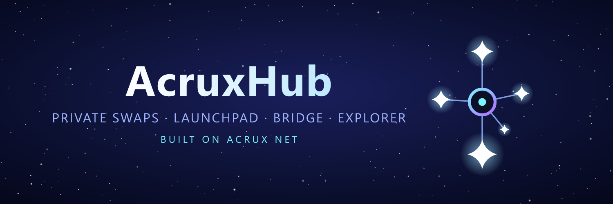

<p align="center">
  
</p>

<p align="center">
  <a href="https://acruxhub.com"><b>acruxhub.com</b></a> ·
  <a href="docs/01-getting-started.md">Docs</a> ·
  <a href="https://x.com/AcruxHub">X</a> ·
  <a href="SECURITY.md">Security</a>
</p>

<p align="center">
  <a href="https://github.com/AcruxHub/AcruxHub/actions/workflows/ci.yml"></a>
  
  
  
</p>

# AcruxHub

The DEX, token launchpad and explorer for [Acrux Net](https://acrux.computer), the 50 ms Solana fork. Live at **[acruxhub.com](https://acruxhub.com)**.

> Independent project, not affiliated with the Acrux team. Acrux Net uses test tokens, and this code has **not been audited**.

## What's live

| | |
|---|---|
| **Private swaps** | Constant-product AMM. On Acrux, every swap goes out as a 2-of-3 threshold-encrypted transaction, so no single block proposer can read it early to front-run or sandwich it. |
| **Raydium routing** | Raydium's CPMM program runs on Acrux at its mainnet address. AcruxHub quotes every AcruxHub and Raydium pool for a pair and routes each swap to the best price. |
| **Raydium pools, no code** | Create Raydium CPMM pools on any of Raydium's 25 fee tiers, and add or remove liquidity, from the Pools page. Raydium's own site doesn't support Acrux. |
| **Launchpad** | Pump-style one-screen coin creation: image, name, ticker, description, links, optional first buy, all in one transaction. Fixed supply, no creator allocation, and at graduation the liquidity is locked forever by burning the LP tokens. |
| **Paste a CA** | Paste any token address on Swap to find its pools, or its launch page while it's still on the curve. |
| **Explorer** | Live Acrux windows, proposers, slots, accounts and transactions. |
| **Portfolio** | Balances and LP positions. |
| **Bridge** | Built and tested (2-of-3 guardians, daily caps, pause), but **not deployed** until it's audited. |

## Contracts (Acrux Net)

| Program | Address |
|---|---|
| AMM | `845G7nDPuxfzqbxEnVsrT72XxG5UJMBvunxhEYyAEMjB` |
| Launchpad | `3qCdE6gNWinKpPX71JZk8DGe2AYsYaVg6v8WB7N3SKrd` |
| Bridge (not deployed) | `D3ct55qQUcEp8RBiD6xU5e923yGN6B1SopFMNhQTc3CT` |

More in [docs/07-contracts.md](docs/07-contracts.md).

## How private swaps work

The signed transaction is encrypted with ChaCha20-Poly1305 under a fresh key. The ciphertext is split into 3 shards with Reed-Solomon coding (any 2 rebuild it), and the key is split the same way with Shamir secret sharing. Each of the slot's three proposers gets one shard and one key share. The swap only becomes readable once two proposers have committed to including it.

[`sdk/src/acrux.ts`](sdk/src/acrux.ts) is an independent implementation of the published Acrux wire format. [`tests/seal.test.ts`](tests/seal.test.ts) checks it byte-for-byte against the Acrux node's own Rust test vectors.

## Repository

```
programs/
  amm/         constant-product pools, LP tokens, min-out + slot deadline   (Anchor 0.31.1)
  launchpad/   bonding curve, fixed supply, graduation into a locked AMM pool
  bridge/      one program on both chains, guardian approvals, caps, pause
sdk/           TypeScript clients, PDA helpers, quote math, Acrux threshold sends
relayer/       bridge guardian daemon
web/           React + Vite app served at acruxhub.com (+ /api/upload for coin images)
docs/          user docs, also rendered on the site's Docs page
tests/         sealer unit tests and end-to-end tests on local chains
scripts/       localnet, deploy and maintenance scripts
```

## Build and test

Rust programs (Linux or WSL; Agave 4.0.3, Anchor 0.31.1):

```bash
anchor build                      # programs + IDLs (SBF v0, which Acrux runs)
cargo test --workspace --lib      # program unit tests
```

TypeScript:

```bash
npm install
npm run test:unit                 # threshold sealer vs Acrux node vectors
bash scripts/localnet.sh run      # two local chains: :8899 "Solana" (id 1), :8999 "Acrux" (id 2)
npm run test:e2e                  # AMM, launchpad, two-chain bridge (needs fresh local chains)
npm run dev --prefix web          # the app on http://localhost:5180
```

Deploying to Acrux needs `--use-rpc` (Acrux has no TPU port):

```bash
solana program deploy --use-rpc -u https://rpc.acrux.computer --program-id <keypair> target/deploy/acruxhub_amm.so
```

## After an Acrux Net reset

Acrux Net starts from a fresh genesis on every restart, which wipes deployed programs and their accounts. Restore everything with one command:

```bash
node --import tsx scripts/acrux-redeploy.ts --check   # what's missing (changes nothing)
node --import tsx scripts/acrux-redeploy.ts           # restore (add --wait to pause for an ACRUX top-up)
```

It redeploys the AMM and the launchpad at the **same addresses** (same program keypairs, so the site needs no change), recreates the AXA/AXB pool, and initializes the launchpad (quote AXB, fees to the treasury). Each step checks the chain first, so re-running is safe.

Funding: the two deploys need about 5.3 + 6.6 ACRUX at their peaks (deploy buffers are refunded after). The faucet gives 3 × 2 ACRUX per key per 24 hours, so a full restore usually needs a top-up to the deployer, and the script prints exactly how much. The site reads the demo-token mints live from `getDemoPool`, since a restart can change them.

## Acrux Net quirks we hit

- `getProgramAccounts` ignores `memcmp` filters, so Anchor's `.all()` returns every account a program owns. Use `allAccounts()` from the SDK, which filters on the client.
- Programs must be built for SBF v0.
- The faucet API only accepts browser requests from acrux.computer, so the app links to the faucet page instead of calling it.
- The live demo-token mints differ from the ones in the Acrux repo's genesis file.

## Security

Unaudited. See [SECURITY.md](SECURITY.md) for what's tested, the known risks, and how to report a vulnerability privately.

## License

[MIT](LICENSE)
